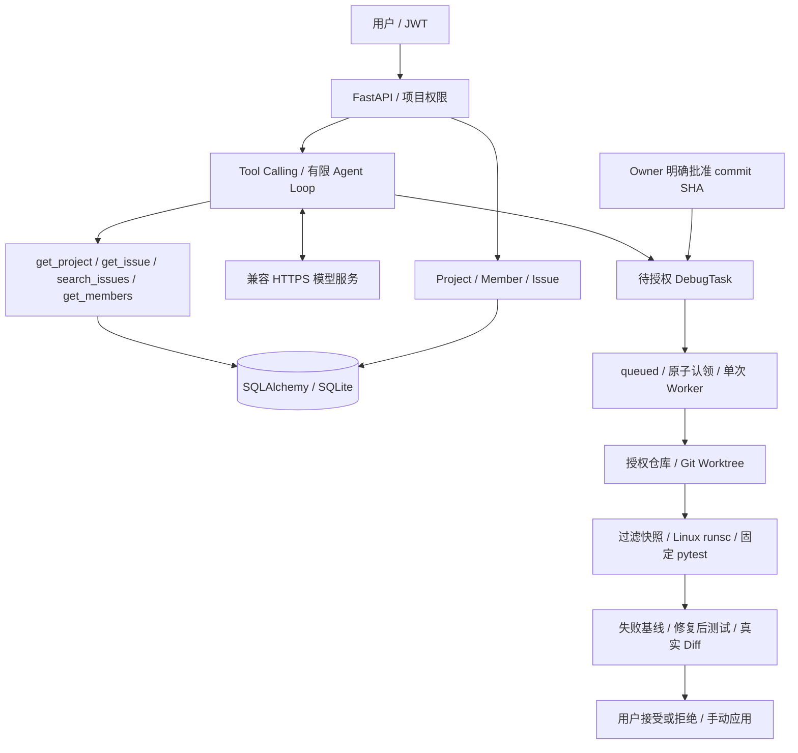

# BugFlow

面向个人开发者和小型团队的 Issue 管理后端，扩展了需要用户审批的 AI Debug Agent。
业务 API 与 Agent 共用 FastAPI、SQLAlchemy、JWT 和项目 Owner/Member 权限，适合展示 Python 后端与 Agent 工程实践。
`main` 保留原业务 v1，Agent 当前位于 `feat/ai-debug-agent-v1`；它是受控学习原型，不是生产级自主修复平台。

## 架构与执行边界



模型只能提出 Debug 请求，不能授予权限。Worker 再次校验 Owner 与仓库绑定；Issue 和源码是非可信数据。
Worktree 隔离版本，runsc 才承担执行隔离：禁网、只读源码、非 root、资源与时间限制。
隔离不可用时拒绝执行。默认不修改原仓库，不自动应用补丁、commit 或 push。
仅支持受限 Python 仓库、现有 app Python 文件修改和固定 pytest；无分布式调度、崩溃恢复或通用修复成功率保证。

AI Debug Agent V1 扩展见 [运行、架构、接口与验收边界](docs/agent-v1.md)。
原有业务 v1 保留；Agent 已于 2026-10-14 通过真实模型 + 本机 WSL2/runsc 的小型修复验收，
当日 Windows 与 Linux 均为 101 项测试通过。这是历史结果，不等于 CI 已运行或通用修复能力。
验收范围和限制见 [验收记录](docs/验收记录.md)，本次离线审计见 [求职展示审计](docs/showcase-audit.md)。

### 使用自己的模型服务

在启动后端的同一个 PowerShell 窗口设置以下环境变量：

```powershell
$env:BUGFLOW_LLM_BASE_URL = 'https://你的兼容服务地址/v1'
$env:BUGFLOW_LLM_MODEL = '服务商提供的支持工具调用的模型名'
$env:BUGFLOW_LLM_API_KEY = Read-Host '输入你自己的 API Key' -MaskInput
```

`-MaskInput` 需要 PowerShell 7.1+；其他环境请使用运行平台的密钥注入功能。
Key 只交给后端，不放进前端请求、代码或 Git。`.env.example` 只是示例，应用不会自动加载 `.env`。
地址填写 API 基础路径，不要附加 `/chat/completions`、查询参数或用户名密码。
当前适配器要求 HTTPS、Bearer 认证及兼容 Chat Completions 的 `tools`、`tool_choice`、`max_tokens`。
启动后的进程不会自动获得另一个终端新设置的变量，修改终端配置后请重启后端和 worker。

DeepSeek 当前验收使用 `https://api.deepseek.com`、`deepseek-flash`，另设
`$env:BUGFLOW_LLM_THINKING = 'disabled'` 显式关闭思考模式。
该配置只接受空值（不发送此字段）或 `disabled`；其他服务不需要时保持未设置。

每个 LLM 实例首次使用工具会做一次无业务数据的 `tool_choice=required` 探测，成功后仍允许普通文本回答。
探测增加一次模型请求和少量费用，不代表该模型的调试能力已经验收。
缺少配置返回 `503 llm_not_configured`；非法配置返回 `503 llm_invalid_config`；
提供商认证失败、不支持工具或返回异常等返回带分类错误码的 `502`，不返回提供商原始错误内容。

BugFlow 是一个面向个人开发者和小型开发团队的轻量 Issue 管理后端。它将项目、成员与 Issue 集中管理，提供认证、权限控制和可追踪的 Issue 状态流转，帮助小团队明确任务归属与处理进度。

## 核心功能

- 用户注册与登录
- JWT Bearer 身份认证与当前用户查询
- Project 创建、查询、部分更新和删除
- Owner / Member / Outsider 项目权限控制
- 项目成员添加、查询和移除
- Issue 创建、查询、部分更新和删除
- assignee 必须是项目中的活跃成员
- Issue priority：`low`、`medium`、`high`、`urgent`
- Issue 状态流转
- pytest API 自动化测试

## Issue 状态流转

```text
open -> in_progress -> resolved -> closed
```

状态只能按上述顺序推进，Owner 与 Member 均可推进合法状态；Outsider 无权访问项目中的 Issue。

## 权限说明

| 操作 | Owner | Member | Outsider |
| --- | --- | --- | --- |
| 查看项目、成员与 Issue | 可以 | 可以 | 不可以 |
| 创建和更新 Issue | 可以 | 可以 | 不可以 |
| 推进合法 Issue 状态 | 可以 | 可以 | 不可以 |
| 管理项目资料和成员 | 可以 | 不可以 | 不可以 |
| 删除 Project 或 Issue | 可以 | 不可以 | 不可以 |

创建 Project 的用户为 Owner，并会自动成为该项目的成员。

## 技术栈

- Python 3.12（建议复现环境；历史 Windows 3.14 / Linux 3.12 验证）
- FastAPI
- SQLAlchemy
- Pydantic
- SQLite
- PyJWT
- pwdlib / Argon2
- pytest

## 项目结构

```text
app/
  main.py           # FastAPI 应用与路由注册
  config.py         # 环境变量配置
  database.py       # SQLAlchemy engine、Base、Session 依赖
  models.py         # User、Project、ProjectMember、Issue ORM 模型
  schemas.py        # Pydantic 请求与响应模型
  security.py       # 密码哈希与 JWT 创建
  dependencies.py   # 当前用户认证依赖
  permissions.py    # 项目与 Issue 权限校验
  agent/            # LLM、查询工具、任务、Worker、Worktree、沙箱
  routers/          # auth、projects、issues、agent API 路由

tests/
  conftest.py       # 内存 SQLite 测试数据库与依赖覆盖
  test_auth.py      # 认证 API 测试
  test_projects.py  # 项目 API 测试
  test_issues.py    # Issue API 测试
  test_agent*.py    # 配置、权限、Agent 编排与传输替身测试
  test_sandbox_cleanup.py # 清理异常回归（不执行 Docker）
scripts/           # 显式手动真实验收与镜像构建
sandbox/           # 可信依赖镜像构建示例
docs/              # Agent 接口、历史验收与面试复盘
.github/workflows/ # 无真实 Key / Docker 的离线 CI
```

## 本地运行

使用 Python 3.12 创建并激活虚拟环境（已有环境可复用）。Windows：

```powershell
py -3.12 -m venv .venv
.\.venv\Scripts\Activate.ps1
```

Linux：`python3.12 -m venv .venv`，然后 `source .venv/bin/activate`。

安装依赖：

```powershell
python -m pip install -r requirements.txt
```

设置本地开发 JWT 密钥。不要将真实密钥提交到 Git：

```powershell
$env:BUGFLOW_SECRET_KEY = python -c "import secrets; print(secrets.token_hex(32))"
```

Linux：`export BUGFLOW_SECRET_KEY="$(python -c 'import secrets; print(secrets.token_hex(32))')"`。
只运行业务与离线测试不需要模型 Key。API 和 Worker 必须使用同一 JWT 配置、任务数据库和仓库白名单。

可选配置：

- `BUGFLOW_DATABASE_URL`：默认 `sqlite:///bugflow.db`
- `BUGFLOW_ACCESS_TOKEN_EXPIRE_MINUTES`：默认 `30`，必须为正整数

第一次运行全新开发数据库时显式建表；已有正式数据先备份，不在启动时自动迁移：

```powershell
python -c "from app.database import Base, engine; import app.models; Base.metadata.create_all(engine)"
python -m app.agent.init_db
```

启动服务：

```powershell
python -m uvicorn app.main:app --reload
```

## API 文档

服务启动后访问 [http://127.0.0.1:8000/docs](http://127.0.0.1:8000/docs) 查看交互式 API 文档。

## 测试

```powershell
python -m pytest -v
```

测试使用隔离的内存 SQLite 数据库，并通过 FastAPI `dependency_overrides` 替换正式数据库依赖，因此不会污染开发使用的 `bugflow.db`。

离线测试使用模型/进程替身及临时 Git 仓库，无需真实 API Key、Docker 或 WSL。
2026-10-15 试投前复核：Windows（Python 3.14.6）与 Linux（Python 3.12.3）各通过 122 项离线测试；
CI 的模型地址使用 `https://offline.invalid/v1` 占位，传输测试由 MockTransport 接管，不调用真实模型。
GitHub Actions 在 Windows/Linux、Python 3.12/3.14 上运行同一 pytest，使用公开的测试专用 JWT 占位值，
不读取仓库 Secrets，不运行 live_acceptance 或付费模型。实际 CI 结果需推送后查看，本地通过不代表云端已通过。
2026-10-14 的真实 Demo 是单个刻意构造的加法 Bug：失败基线 → 模型补丁 → 测试通过 → 非空 Diff，
不能将离线测试数量解读成修复过相同数量的真实 Bug。

## 当前版本范围

BugFlow v1 暂不包含：

- Comment
- Notification
- 文件上传
- 原始业务 v1 不包含 AI；可选 Agent 扩展范围与限制见上方文档
- Redis / Kafka
- 微服务
