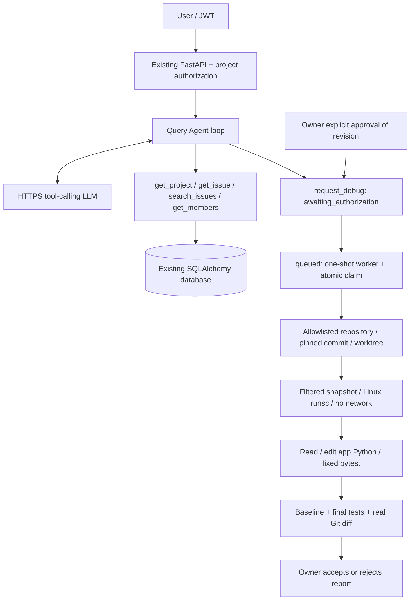

# BugFlow AI Debug Agent V1

## Current implementation and acceptance boundary

Agent V1 extends the existing FastAPI application, JWT dependency and project access checks.
It is not a Codex CLI wrapper and does not load Skills. The original 46 tests remain.
The HTTP LLM client uses real Chat Completions function calling. There is no production mock fallback.
Model and process doubles in pytest validate control flow only; they do not prove a real model repaired code.

On 2026-10-14, a real model + Linux runsc repair passed using a disposable addition-bug repository,
JWT API approval and an in-memory database. This is a bounded V1 demo, not a production security certification.
Both Windows and Ubuntu full suites passed 101 tests. See [acceptance record](验收记录.md).
Worktree creation, actual file editing, diff and cleanup are independently tested using temporary Git repositories.

## Architecture



State machine: `awaiting_authorization -> queued -> running -> succeeded | failed | timed_out`.
Owner may cancel pending/queued/running tasks. A cancelled task cannot be overwritten by worker completion.
Successful reports allow one review: `accepted` or `rejected`. Neither applies patches, commits or pushes.
Approval is not exposed as an LLM tool. Approval records the authenticated owner and exact commit SHA.
Worker revalidates owner activity/ownership and the operator-maintained repository binding.

## Setup

Use Python 3.14 (the version exercised here) and a project virtual environment:

```powershell
python -m venv .venv
.\.venv\Scripts\Activate.ps1
python -m pip install -r requirements.txt
$env:BUGFLOW_SECRET_KEY = python -c "import secrets; print(secrets.token_hex(32))"
$env:BUGFLOW_LLM_API_KEY = Read-Host 'Your provider API Key (PowerShell 7.1+)' -MaskInput
$env:BUGFLOW_LLM_MODEL = '<provider model supporting tool calling>'
$env:BUGFLOW_LLM_BASE_URL = 'https://api.openai.com/v1'
```

The LLM adapter validates nonblank key/model and an HTTPS base URL without credentials, query or fragment.
Supply a base URL, not a full `/chat/completions` endpoint. Restart backend/worker after changing their
process environment. `.env.example` is documentation, not an auto-loaded settings file.
Only providers compatible with Bearer auth, Chat Completions, tools/tool_choice and max_tokens are supported.
Each LLM instance performs one harmless required-tool probe before sending business context; configuration
changes invalidate this cached check. This adds one billable model request. Ordinary text answers remain valid
after a successful probe. Capability verification is not a guarantee of model reasoning or repair quality.

API failures contain a safe `code` and `trace_id`: configuration errors use HTTP 503; model/provider failures
use HTTP 502. Codes include `llm_not_configured`, `llm_invalid_config`, `llm_auth_failed`,
`llm_model_or_endpoint_not_found`, `llm_tools_unsupported`, `llm_request_rejected`, `llm_rate_limited`,
`llm_unavailable`, `llm_timeout`, `llm_invalid_response` and `llm_secret_echo`.
Unknown provider rejections remain `llm_request_rejected`, not a guessed diagnosis. Trace stores only safe codes.
Exact configured-key echoes in model content/tool fields/decoded arguments are blocked before returning to
the Agent loop. This is defense in depth, not a guarantee against every encoded or transformed secret echo.

An existing BugFlow database needs only the two additive Agent tables:

```powershell
python -m app.agent.init_db
```

For a completely new database initialize the original tables first (import models before create_all):

```powershell
python -c "from app.database import Base, engine; import app.models; Base.metadata.create_all(engine)"
python -m app.agent.init_db
uvicorn app.main:app --reload
```

No startup migration runs automatically. Back up a real database before schema operations.
This implementation did not initialize or alter the existing development database.

## Repository authorization and execution environment

Only the operator sets `BUGFLOW_AGENT_REPOSITORIES`, a JSON mapping:

```json
{"bugflow-demo": {"project_id": 1, "path": "/srv/repositories/approved-demo"}}
```

Clients and models supply only `bugflow-demo`; arbitrary paths and project mismatches are rejected.
The operator must vet repository configuration and exclude credentials from committed source before binding.
Source and Issue content may be sent to the configured LLM: bind only data approved for that provider.
V1 copies at most 200 regular text source files, 100 KB each / 2 MB total; no symlinks or submodules.
Dotfiles and suspicious credential filenames are excluded. This is not a general secret scanner.
Only existing `app/*.py` files can be edited. No test edits, shell commands, package installs or network tools.
Repositories requiring binary assets, network services or undeclared dependencies are out of scope.

Deploy the worker to a dedicated Linux execution host with Docker, gVisor `runsc`, and a vetted prebuilt
Python dependency image. Set `BUGFLOW_SANDBOX_IMAGE=your-image@sha256:<64 hex digest>`, or a full
local content-addressed `sha256:<64 hex image ID>`; mutable tags are rejected and the image must exist locally.
Build/provision that image outside Agent execution; the Agent never pulls or builds repository Dockerfiles.
The image must provide `/bin/sh`, Python, pytest and the target repository's dependencies.
The API and worker must share the task database and operator registry. For SQLite use one local host;
do not put SQLite on a network filesystem. Run one worker invocation per task:

```sh
python -m app.agent.worker
```

The sandbox requires runsc, no network, read-only rootfs, non-root UID, all capabilities dropped,
no privilege escalation, 64 PIDs, 512 MB memory, one CPU, bounded tmpfs and 60 seconds per test command.
Only filtered source is mounted read-only; tests execute on a temporary copy. No home, .git, Docker socket,
API key or host environment is mounted into the container. Worktree alone is NOT a security sandbox.
The operator/runtime remains trusted. Hardened containers are not a claim of absolute isolation.

## API and demo

All endpoints require the existing JWT. `/docs` contains request schemas.

| Method / path | Purpose / authorization |
| --- | --- |
| POST /agent/chat | `{project_id, message}`; project member or owner |
| GET /agent/traces/{id} | tool names, outcomes and status; project access |
| GET /agent/tasks/{id} | exact revision, reason, status and report; project access |
| POST /agent/tasks/{id}/approve | owner; `{authorize_code_execution: true, revision: "exact SHA"}` |
| POST /agent/tasks/{id}/cancel | owner; pending/queued/running only |
| POST /agent/tasks/{id}/review | owner; `{decision: "accepted"}` or `rejected`; successful report only |

1. Register/login Owner, create Project; optionally add Member using existing APIs.
2. Bind a disposable bug fixture repository to that project as operator.
3. Ask `/agent/chat`: "List this project's Issues". Check actual tool observations in the trace.
4. Ask: "Investigate Issue 1 using repository alias bugflow-demo; propose debug if necessary."
5. Inspect returned task via GET; approve its exact revision using the separate owner endpoint.
6. Run the worker with a real key and approved Linux sandbox. Poll the task.
7. Inspect baseline, tests, diff and model summary. A verified result requires baseline pytest exit 1,
   a real nonempty diff, and a post-edit pytest exit 0. Model text alone cannot set success.
8. Accept/reject the report. Applying a reviewed patch remains an explicit manual operation.

Do not label a missing-key or missing-sandbox demo as a successful AI repair.

## Tests and eval

```sh
python -m pytest -v
python -m pytest tests/test_agent.py tests/test_agent_execution.py tests/test_agent_transport.py -v
```

All API tests override get_db with in-memory SQLite. Temporary Git fixtures have no connection to bugflow.db.
Offline eval measures authorization rejection, real tool observations, invalid tool handling, model failure,
approval replay, safe paths, real worktree diff/cleanup, timeout and test-failure handling.
Scripted model/process results are labelled test doubles. Live eval still requires a real provider and sandbox.

Live query eval: export `BUGFLOW_EVAL_TOKEN` (existing JWT), `BUGFLOW_EVAL_PROJECT_ID`, optionally
`BUGFLOW_EVAL_API`, then run `python -m app.agent.eval`. It verifies three real tool selections through
the running API and its persisted traces, prints pass/fail, and exits nonzero on failure.
It does not measure repair correctness. The standalone query evaluator was not used in this acceptance;
actual query tools and Debug were exercised by the real end-to-end script below.

### Reproduce the small live acceptance

The worker must run inside Linux (WSL2 Ubuntu is sufficient when runsc checks pass).
Install official Docker/runsc following their docs. Provision a trusted digest-pinned image containing pytest.
`sandbox/Dockerfile` accepts a digest-pinned Python base and local wheels. If Docker Hub is unavailable,
`scripts/build_local_sandbox.py` builds from the dedicated Ubuntu venv and system Python/runtime libraries;
it includes no source repository, home directory or credentials. It is an operator provisioning script.

```sh
python scripts/build_local_sandbox.py
export BUGFLOW_SANDBOX_IMAGE=sha256:<the actual ID printed above>
python scripts/check_sandbox.py
# Set the LLM variables in this Linux process, including BUGFLOW_LLM_THINKING=disabled for DeepSeek.
python scripts/live_acceptance.py
```

The live script creates a disposable Git repo and in-memory database, drives register/login/project/Issue,
real model query + Debug proposal, owner approval, worker repair and report review. Its result includes
baseline failure, actual sandbox tests, actual diff and whether the original repo remained unchanged.
It removes the fixture afterward. Do not run it without an API budget and vetted sandbox.
For safe Windows-to-Linux bridging, `--config-stdin` accepts a JSON line of LLM configuration plus image ID;
never put keys in command arguments or repository files. `.env.example` is not auto-loaded.
`BUGFLOW_LLM_THINKING` accepts only unset/empty or `disabled`; V1 does not implement thinking-history forwarding.

## Known V1 limitations

- Live acceptance covers one intentionally simple Python bug; broad real-world repair quality is not measured.
- No distributed queue, background scheduler, automatic crash recovery or high-availability guarantees.
  A worker killed externally can leave `running`; an owner can cancel it. Container cleanup after a host crash
  is an operator responsibility. Do not deploy an unattended worker fleet from this V1.
- Deadline checks are cooperative between bounded operations; cancellation waits for an in-flight LLM request.
- On execution exceptions the task records a sanitized error; partial diff/log recovery is not implemented.
- No arbitrary repository language/build command support, test generation, patch application or branch publishing.
- No provider quality benchmark: deterministic eval verifies orchestration, not model debugging intelligence.
- No per-user rate limiting or billing controls; deploy as a private development service.

References: [tool calling](https://developers.openai.com/api/docs/guides/function-calling),
[Docker security](https://docs.docker.com/engine/security/),
[disabled networking](https://docs.docker.com/engine/network/drivers/none/).
